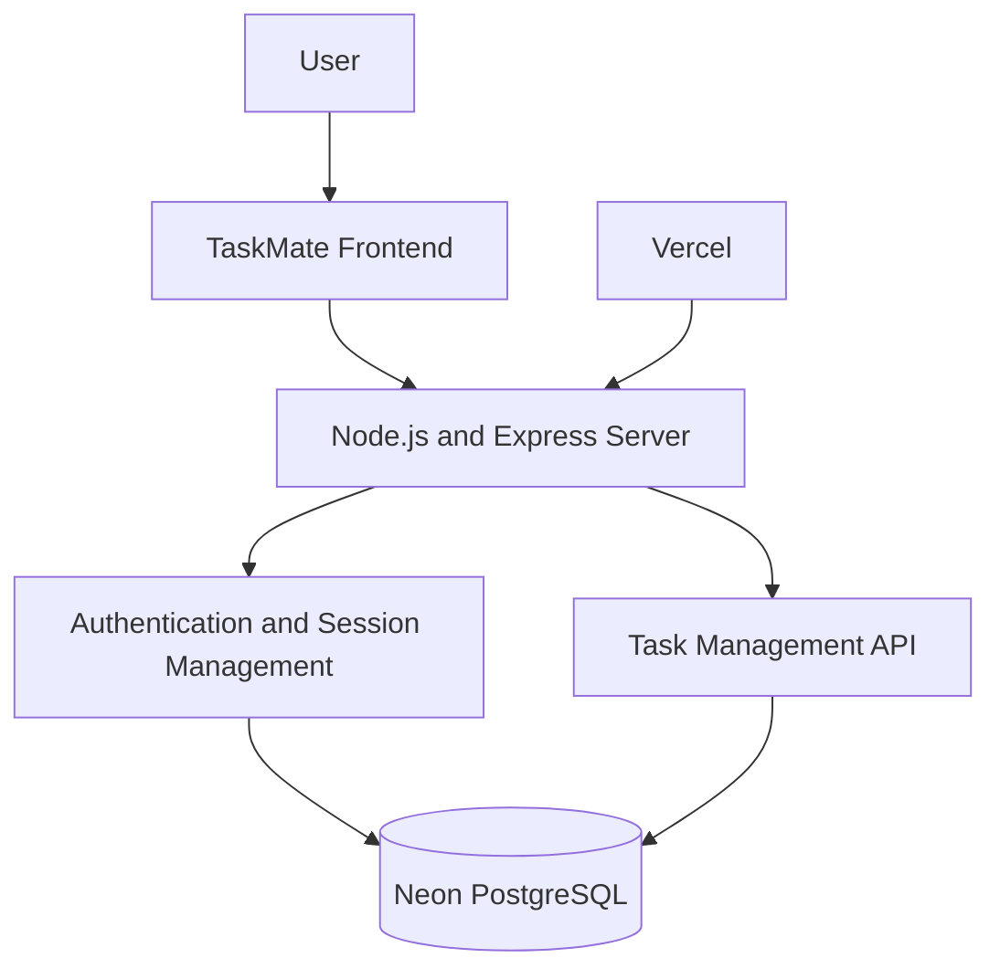

# TaskMate

A PostgreSQL-powered task management application designed to help users organize, manage, and track their daily tasks.

## Live Demo
https://taskmate-l64em61du-pennidhi.vercel.app/

## Technologies Used
- HTML
- CSS
- JavaScript
- Node.js
- Express.js
- PostgreSQL
- Neon Database
- Vercel

## Features
- User registration and login
- Secure password hashing
- Individual user accounts
- Add, view, update and delete tasks
- Mark tasks as completed
- Persistent PostgreSQL storage

## Installation

1. Clone the repository:
   git clone https://github.com/pennidhiramch-boop/Taskmate.git

2. Install dependencies:
   npm install

3. Create a `.env` file and add:
   DATABASE_URL=your_neon_database_url
   SESSION_SECRET=your_secret_key

4. Start the application:
   npm start

5. Open http://localhost:3000

## Database
TaskMate uses PostgreSQL through Neon to store user accounts, tasks and sessions.

## Architecture

## Demo Videos

### Application Demo
[Watch TaskMate Application Demo]
https://drive.google.com/file/d/17Obh7RkaZnNn6T6hb0t_bxzz7LBtLmTG/view?usp=sharing

### PostgreSQL Database Demo
[Watch PostgreSQL Database Demo]
https://drive.google.com/file/d/1yfedf-vhs3CYfilP33HDlg72Fm11pBUR/view?usp=sharing

## Author
Pennidhi
